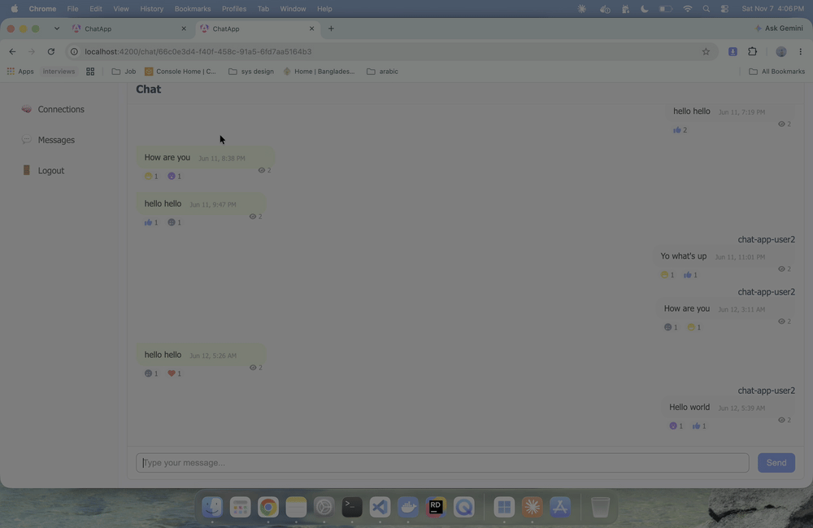
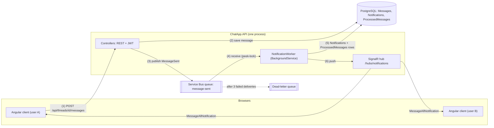

# Chat App

A one-to-one chat app: an ASP.NET Core 8 Web API (clean architecture, EF Core + PostgreSQL, JWT, SignalR) and an Angular 19 client.
Users register and log in, send and accept friend requests, and chat in real time with replies, reactions and seen status.
When a message is sent, the API publishes a `MessageSent` event to an Azure Service Bus queue; a background worker turns it into notification rows and a SignalR push.



## Contents
- [Architecture](#architecture)
- [Why Service Bus](#why-service-bus)
- [Run locally](#run-locally)
- [Tests](#tests)
- [CI](#ci)
- [Deploy](#deploy)
- [Known limitations](#known-limitations)
- [Screenshots](#screenshots)

## Architecture



The same flow runs in two places:

| | Local | Azure (scripted, see [Deploy](#deploy)) |
|---|---|---|
| Service Bus | Service Bus emulator + its SQL Server in Docker (`servicebus` compose profile), queue from `servicebus-emulator/Config.json` | Service Bus namespace (Basic tier), queue created by `deploy/azure/provision.sh` |
| PostgreSQL | `postgres:15` container from `docker-compose.yml` | Azure Database for PostgreSQL Flexible Server (B1ms) |
| API + worker | `dotnet run` | Container Apps, image from `ghcr.io/learning-projects-v1/chat-api` |

`ServiceBus:Enabled` switches the queue on or off. It is `false` by default (`appsettings.json`): then `InProcessEventPublisher` runs the same `MessageSentHandler` inside the HTTP request, so the app works without Service Bus. With `true`, `ServiceBusEventPublisher` sends to the `message-sent` queue and `NotificationWorker` consumes it.

### Project layers (`backend/`)

| Project | What is in it |
|---|---|
| `ChatApp.Domain` | Entities (`User`, `Friendship`, `ChatThread`, `ChatThreadMember`, `Message`, `Reaction`, `MessageSeenStatus`, `Notification`, `ProcessedMessage`) and constants. No dependencies. |
| `ChatApp.Application` | DTOs, repository and service interfaces (`IEventPublisher`, `IRealTimeNotifier`, `IUnitOfWork`, ...), `AuthService`, the `MessageSent` event and `MessageSentHandler`. |
| `ChatApp.Infrastructure` | EF Core `ChatAppDbContext` + migrations, repositories, `UnitOfWork` (turns a Postgres unique violation into `DuplicateKeyException`), `JwtTokenGenerator`, the thread-member authorization handler, `ServiceBusEventPublisher` and `InProcessEventPublisher`. |
| `ChatApp.Api` | Controllers, the SignalR `NotificationHub` and `RealTimeNotifier`, `NotificationWorker`, DI setup (`Middleware/*Registration*.cs`), `Program.cs`, `/health`. |
| `tests/ChatApp.UnitTests`, `tests/ChatApp.IntegrationTests` | See [Tests](#tests). |

The Angular client is in `frontend/chatApp`.

## Why Service Bus

**Queue instead of inline.**
Before, when a new message was sent, the API saved it and then sent the notifications through SignalR inline, in the same request. Now the API saves the message, publishes one `MessageSent` event to the message broker and returns. A worker sends the notifications to the recipients. We get the broker's benefits: notifications are delivered asynchronously, failed ones are retried, and a failure in the notification code no longer fails the user's send.

**At-least-once delivery.**
The worker receives a message in peek-lock mode: the message is locked for 30 s so other consumers can't pick it up, and then it is passed to the handler. The worker completes the message only after the handler succeeds (`AutoCompleteMessages = false`). If the handler throws, the message is abandoned; if the worker crashes, the lock expires. Either way, Service Bus delivers the message again. So a message is never lost, but it can arrive more than once, and the handler has to handle duplicates (next paragraph). At-least-once delivery plus an idempotent handler means the notification rows are saved exactly once. The live SignalR push runs after the save, so it happens at most once: if the worker crashes after the save but before the push, the push is lost. The notification row is still in the database, but no endpoint reads it yet (see [Known limitations](#known-limitations)).

**The duplicate guard.**
The chat message id is used as the Service Bus `MessageId`. Before processing an event, the handler checks the `ProcessedMessages` table for that id and skips the event if it was processed before. Otherwise it saves the `Notifications` rows and the `ProcessedMessages` row in a single transaction. If two deliveries pass the check at the same time, the primary key on `ProcessedMessages.MessageId` lets only one of them commit; the other gets a `DuplicateKeyException` and is treated as a duplicate. A duplicate is completed, not abandoned, because we don't want it redelivered.

**When the worker is down.**
If the worker is down, nothing is delivered and the messages wait in the queue. Their delivery count doesn't go up, because nobody tried them. When the worker comes back, it works through the backlog. Messages older than the time-to-live (1 hour) expire and are dropped, because dead-lettering on expiry is off. The worker only sends notifications, so it doesn't block message sending. But it runs in the API process, so if the whole process is down, sending is down too.

**Dead-letter queue.**
After `MaxDeliveryCount` failed deliveries (3 here, in both the emulator config and the Azure script), the message is moved to the queue's dead-letter queue. Nothing in the app reads it. It can be inspected and resubmitted in Service Bus Explorer in the Azure portal.

**Known gap: no outbox.**
The message is saved to Postgres before the event is published. If the API crashes, or the publish fails, after the save, the message exists but no notification is ever sent (and on a failed publish the request returns an error even though the message was saved). The transactional outbox pattern would solve this: write the event to an outbox table in the same transaction as the message, and publish it from there. It is not built.

## Run locally

Prerequisites: Docker, the .NET 8 SDK, Node.js 20 (for the Angular client).

**1. PostgreSQL**
```bash
docker compose up -d          # starts only postgres (chat-postgres, port 5432, db ChatAppDb, user postgres / password)
```
The container name is fixed (`chat-postgres`), so remove an old container with that name first if compose reports a conflict.

**2. API settings.** `appsettings.Development.json` is git-ignored, so create it in `backend/ChatApp.Api/` (or pass the same keys as environment variables, e.g. `JwtSettings__Secret`):
```json
{
  "ConnectionStrings": {
    "DefaultConnection": "Host=localhost;Port=5432;Database=ChatAppDb;Username=postgres;Password=password"
  },
  "JwtSettings": {
    "Secret": "<any string of 32+ characters>",
    "Issuer": "ChatApp",
    "Audience": "ChatApp.Client",
    "AccessTokenExpirationMinutes": 60
  },
  "RunMigrations": true
}
```
`RunMigrations: true` applies the EF Core migrations at startup and seeds demo data (only when the `Users` table is empty). `ClearDatabase: true` would also drop the database on every start.

**3. API** (without Service Bus: `ServiceBus:Enabled` is `false` by default)
```bash
dotnet run --project backend/ChatApp.Api --launch-profile http
```
- API: http://localhost:5000 · Swagger: http://localhost:5000/swagger · health: http://localhost:5000/health
- SignalR hub: `/hubs/notifications`

**4. Angular client**
```bash
cd frontend/chatApp
npm install
npx ng serve                  # http://localhost:4200, talks to http://localhost:5000 (src/app/environments/environment.ts)
```

**Demo users:** `u1@gmail.com` ... `u15@gmail.com` from the seed data. They log in with any password (see [Known limitations](#known-limitations)). `u1` is friends with everyone, so two windows as `u1` and `u2` share a thread. You can also register a new user, but new users have no threads yet.

### With the Service Bus emulator

```bash
ACCEPT_EULA=Y docker compose --profile servicebus up -d    # postgres + servicebus-sql + servicebus
```
`ACCEPT_EULA=Y` accepts the emulator's and SQL Server Developer's licence terms (dev/test use only). The emulator reads the `message-sent` queue from `servicebus-emulator/Config.json`. Ports: 5672 (AMQP), 5300 (http://localhost:5300/health). The SQL Server image is x64 only; on Apple silicon Docker Desktop runs it under Rosetta.

Then start the API with the queue switched on:
```bash
ServiceBus__Enabled=true \
ConnectionStrings__ServiceBus="Endpoint=sb://localhost;SharedAccessKeyName=RootManageSharedAccessKey;SharedAccessKey=SAS_KEY_VALUE;UseDevelopmentEmulator=true;" \
dotnet run --project backend/ChatApp.Api --launch-profile http
```
Each sent message should log `Processed MessageSent <id> from the message-sent queue (attempt 1).` from `NotificationWorker`.

Stop everything with `docker compose --profile servicebus down` (add `-v` to delete the Postgres volume).

## Tests

```bash
dotnet test backend/tests/ChatApp.UnitTests/ChatApp.UnitTests.csproj
dotnet test backend/tests/ChatApp.IntegrationTests/ChatApp.IntegrationTests.csproj   # needs Docker running
```

- **Unit tests** (xUnit + NSubstitute, no database): `AuthService` register/login, `FriendsController` send/accept rules, `MessagesController.SendMessage` (thread not found, publishes `MessageSent` for all thread members, sender taken from the token and not the request body), JWT and claims helpers, and `MessageSentHandler` (notifies everyone except the sender, same message id twice creates one notification, losing the race on the inbox key skips the push).
- **Integration tests** (`WebApplicationFactory<Program>` + Testcontainers): the real `Program.cs`, DI, JWT auth and EF Core against a PostgreSQL 16 container with the real migrations. They cover register → login → send → fetch, a request without a token getting 401, `/health`, and the in-process notification path. A second fixture adds the Service Bus emulator and its SQL Server, and checks that a notification arrives through the queue and that the same message delivered twice creates one notification. Those two are slower (about a minute to start); set `SKIP_SERVICEBUS_TESTS=true` to skip them.

<!-- rewrite in your words -->
**Why Testcontainers and not the EF Core InMemory provider.** InMemory is not a relational database: it doesn't run migrations, doesn't enforce unique indexes, has no real transactions and translates queries differently from Npgsql. The duplicate guard depends on a Postgres primary-key violation inside a transaction, and the schema comes from migrations, so those need a real Postgres to be tested at all. The cost is speed and needing Docker.

## CI

Two GitHub Actions workflows in `.github/workflows/`:

- **`ci.yml`** (the badge above): on every push and pull request to `main`. Restores and builds the solution in Release on .NET 8, runs the unit tests, then the integration tests. The `ubuntu-latest` runner has Docker, so Testcontainers starts Postgres and the Service Bus emulator there.
- **`image.yml`**: on pushes to `main` that touch `backend/**` (or by hand). Builds the API Docker image (`backend/Dockerfile`, linux/amd64) and pushes it to `ghcr.io/learning-projects-v1/chat-api`, tagged `sha-<short>` and, on `main`, `latest`. It does not deploy.

## Deploy

The Azure deploy is scripted, not automatic: `deploy/azure/provision.sh` uses the `az` CLI to create a resource group with a Container Apps environment, the API container app (image from GHCR, max 1 replica, `ServiceBus__Enabled=true`), a Service Bus Basic namespace with the `message-sent` queue, a PostgreSQL Flexible Server and a Log Analytics workspace, then prints the public URL. `./deploy/azure/provision.sh teardown` deletes the resource group.

Steps, cost, how to check the flow end to end and the deploy's own limits: [`deploy/azure/README.md`](deploy/azure/README.md).

Public URL: https://chatapp-api.salmonflower-9397f601.koreacentral.azurecontainerapps.io. `/health` returns 200, with a 7.5 s cold start.


## Known limitations

- **No outbox** (see [Why Service Bus](#why-service-bus)): a failed publish leaves a saved message with no notification.
- **Notifications are written but not read.** `Notifications` rows are created for each recipient, but no endpoint returns them yet; the client only uses the live SignalR push.
- **One replica.** The worker and the SignalR hub run in the API process with no SignalR backplane, so the API can't scale out yet.
- **`ProcessedMessages` grows forever.** Nothing cleans old rows up.
- **Demo logins skip the password check.** `AuthService.LoginAsync` lets the seeded `u1`...`u15@gmail.com` in with any password. Registered users are checked with BCrypt.
- **No refresh tokens.** `RefreshAsync` throws `NotImplementedException`; there is only the access token.
- **Threads only come from seed data.** There is no endpoint to create a thread, and accepting a friend request doesn't create one. The client has a reject-request call, but the API has no reject endpoint.
- **No presence tracking.** `User.IsOnline` exists but nothing sets it.
- **No frontend tests**, and the Angular client is not part of the Azure deploy. `docker-compose.yml` runs only Postgres and the Service Bus emulator, not the API or client.

## Screenshots

<details>
<summary>Login, connections, chat list, chat, reply, reactions, seen status</summary>

<p align="center"></p>
<p align="center"></p>
<p align="center"></p>
<p align="center"></p>
<p align="center"></p>
<p align="center"></p>
<p align="center"></p>
<p align="center"></p>

</details>

## Author
Md Jakir Hossen · [GitHub](https://github.com/Zakir-sust) · [LinkedIn](https://www.linkedin.com/in/jakir68)
